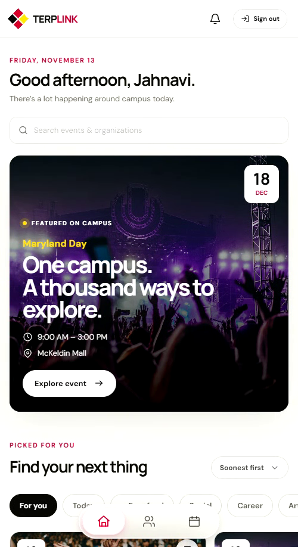
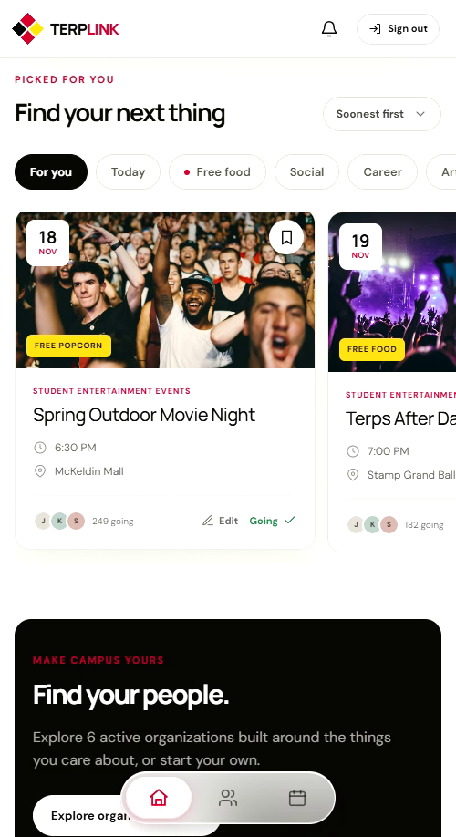
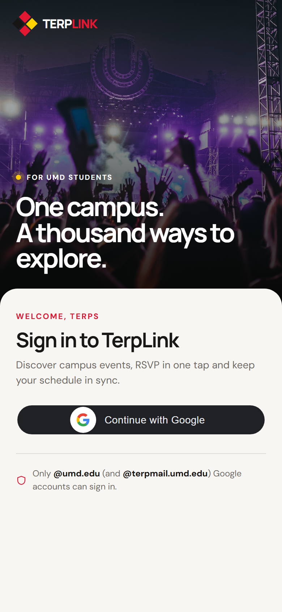
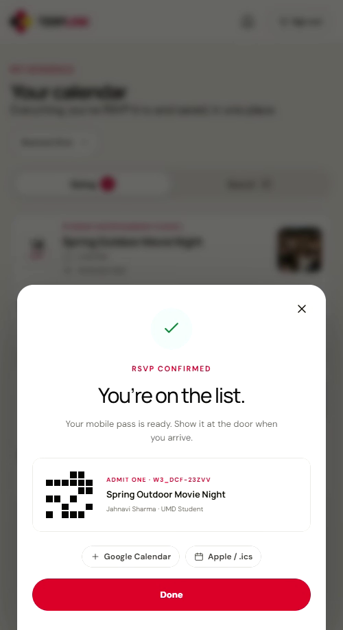
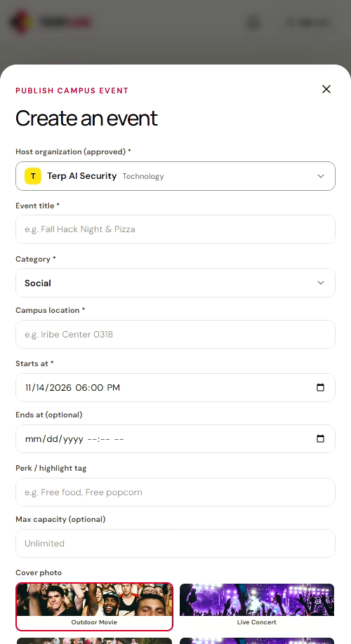
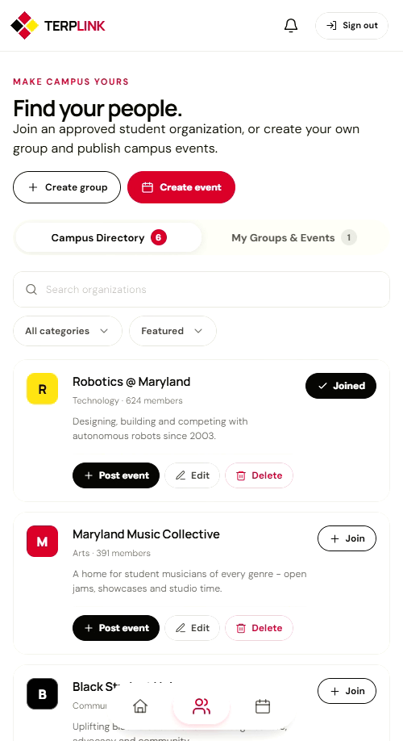
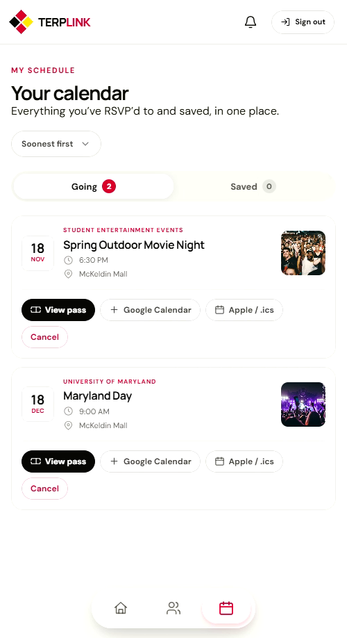

# INST 630 Final Project Checkpoint Report
**Project Name:** TerpLink Mobile (*TerpEvents*)  
**Author:** Jahnavi Sharma (`jahnavi5@umd.edu`)  
**Course:** INST 630 — Introduction to Programming for the Web (Fall 2026)  
**Date:** November 13, 2026  

---

## 1. Project Overview

* **Application Name:** **TerpLink Mobile** (*TerpEvents*)
* **Purpose of the Application:** TerpLink Mobile is a responsive, mobile-first web application (`client/` paired with a fully functional Node.js/Express + MongoDB backend in `server/`) designed to reimagine and streamline how University of Maryland (UMD) students discover, filter, RSVP to, and manage campus events and student organizations on their phones.
* **Problem It Solves:** While UMD's official TerpLink portal serves as the central administrative directory for registered student organizations and campus programming, its legacy desktop-oriented interface is cumbersome to navigate on mobile screens. Students frequently miss out on club meetings, career mixers, cultural showcases, and free-food events because finding relevant activities requires clicking through cluttered menus and slow page reloads. TerpLink Mobile bridges this campus engagement gap by delivering a fast, social-media-inspired mobile event feed where exploring campus life is as effortless as scrolling on a phone.
* **Intended Users:**
  1. **UMD Undergraduate & Graduate Students (`@umd.edu` / `@terpmail.umd.edu`):** Students looking to discover upcoming campus events, filter by perks (such as free food) or interests, RSVP for instant digital admission passes, sync events to their personal calendars, and join student organizations.
  2. **Student Organization Leaders:** Club officers who create student groups, publish new campus events, manage event capacities, and update event details.
  3. **Campus Administrators (`jahnavi5@umd.edu`):** Platform administrators who review and approve or reject new student organization requests and oversee campus events.
* **Major Functionality Planned:**
  * **UMD Campus Google OAuth Authentication Gate:** Secure sign-in via Google Identity Services (`POST /api/auth/google`) verified on the backend server and restricted strictly to University of Maryland email domains (`@umd.edu` and `@terpmail.umd.edu`).
  * **Mobile-First Home Feed & Event Discovery:** A dynamic landing feed featuring a hero spotlight (*Maryland Day*), time-aware student greeting, search bar, category filter pills (*For you*, *Today*, *Free food*, *Social*, *Career*, *Arts & Music*), snap-scrolling event cards on mobile viewports (`<= 640px`), and a fixed mobile bottom navigation bar (with an expanded `/discover` catalog planned for the final submission).
  * **Event Details & One-Tap RSVP with Digital QR Pass:** Detailed mobile bottom-sheet modal displaying event descriptions, host organization info, live attendance/capacity counters, a direct Google Maps campus building directions link, 1-tap RSVP registration (`POST /api/events/:id/rsvp`), and a deterministically generated **Admit One** digital QR code pass.
  * **External Calendar Integration:** One-click export of RSVP'd events to **Google Calendar** (via `googleCalendarUrl()`) and **Apple / Outlook Calendar** (via `downloadICS()`, generating RFC 5545 `.ics` calendar files with a 1-hour reminder alarm).
  * **Student Organization Hub & Event Publishing Forms:** Searchable directory of UMD clubs with 1-tap *Join / Leave* toggles, organization profile modals showing upcoming event lineups, and validated Create/Edit Group and Create/Edit Event forms.
  * **Personal Calendar, Profile & Admin Tools:** Dedicated *My Calendar* page (*Going* and *Saved* tabs) implemented now, with a dedicated *Profile & Preferences* page and *Admin Moderation Dashboard* planned for the final phase.

---

## 2. Progress Since the Proposal

Since submitting the initial project proposal, the core frontend screens, interactive forms, external API integrations, and backend server connection have been built:

1. **Pages Created:**
   * Implemented five core mobile-first screens in `client/js/main.js`:
     * **Splash screen** (`ensureSplash()` — animated TerpLink brand mark while verifying session status)
     * **Login screen** (`/login` — UMD Google Sign-In screen)
     * **Home screen** (`/` — personalized greeting, mobile search, featured campus hero spotlight, category pills, sort controls, snap-scroll event cards, and organization spotlight)
     * **Groups screen** (`/groups` — searchable student organization directory with *Join / Joined* toggles and *My Groups & Events* management tab)
     * **Calendar screen** (`/calendar` — *Going* and *Saved* tabs with digital pass access, calendar export, and RSVP cancellation)
   * Built mobile bottom-sheet modals in `client/js/modals.js` supporting these pages: **Event Details & RSVP QR Pass Modal** (`renderRsvpModal()`), **Organization Profile & Event Lineup Modal** (`renderOrgDetailModal()`), **Create/Edit Group Form Modal** (`renderGroupModal()`), and **Create/Edit Event Form Modal** (`renderEventModal()`).
2. **Semantic HTML5 & Responsive Mobile-First CSS Shell Completed:**
   * Constructed `client/index.html` and modular stylesheets (`client/css/reset.css`, `client/css/index.css`, `client/css/app.css`) with semantic landmarks (`<header class="topbar">`, `<main>`, `<section>`, `<article class="event-card">`, and `<nav class="mobile-nav">`), accessible custom dropdowns (`client/js/dropdown.js`), a topbar **Sign out** control, and a 3-tab mobile bottom navigation bar (`Home`, `Groups`, `Calendar`).
3. **JavaScript Functionality Implemented:**
   * Connected `client/` (`client/js/api.js` and `client/dev-server.js` proxying `/api` to `http://localhost:5000/api`) to the working **Express + MongoDB backend server** (`server/`).
   * Integrated live endpoints for authentication (`/api/auth/config`, `/api/auth/google`, `/api/auth/me`, `/api/auth/logout`), alongside live backend data loading and mutations for Home, Groups, and Calendar (`/api/events`, `/api/organizations`, RSVPs, bookmarks, and group membership).
   * Implemented real-time search, category filtering, multi-mode sorting (`filterEvents()` and `sortEvents()` in `client/js/format.js`), and dynamic DOM updates without page reloads.
4. **Forms Created:**
   * Integrated the **Google Identity Services Sign-In Flow** on `/login` (with backend verification of `@umd.edu` and `@terpmail.umd.edu` domains in `server/src/routes/auth.js`).
   * Built the **Create/Edit Group Form** (`renderGroupModal()`) with live monogram badge preview, category and color dropdowns, description field, and validation.
   * Built the **Create/Edit Event Form** (`renderEventModal()`) with cover photo presets, date/time validation, capacity bounds (`1–50000`), and host organization selection.
5. **Data & External APIs Identified and Implemented:**
   * Implemented `googleCalendarUrl()` and `downloadICS()` in `client/js/format.js` plus **Google Maps building directions links** (`campusMapsUrl()`) in `client/js/modals.js`.
6. **GitHub Repository / Site Established:**
   * We will be setting up a new GitHub repository for the project; static bundle build scripts (`client/build.js`) and Vercel API proxy rewrites (`client/vercel.json` and `server/vercel.json`) are already configured.

---

## 3. Current Application Structure

The table below summarizes the pages and features currently implemented in `client/` (backed by the fully functional Express + MongoDB `server/`), as well as items remaining for final submission:

| Page / Feature | Route / Component | Purpose | Status |
| :--- | :--- | :--- | :--- |
| **Splash Screen** | `ensureSplash()` (`client/js/main.js`) | Displays animated UMD TerpLink brand mark while checking `/api/auth/config` and `/api/auth/me` | **Complete** |
| **Login Screen** | `/login` (`client/js/main.js`) | Authenticates UMD students (`@umd.edu` / `@terpmail.umd.edu`) via Google Identity Services and `/api/auth/google` | **Complete** |
| **Home Screen** | `/` (`client/js/main.js`) | Displays time-based greeting, mobile search bar, *Maryland Day* hero card, category filter pills, sort menu, snap-scroll event cards, and club spotlight | **Complete** |
| **Groups Screen** | `/groups` (`client/js/main.js`, `modals.js`) | Searchable UMD student organization directory with *Join/Joined* toggle, organization detail modal, and *My Groups & Events* tab | **Complete** |
| **Calendar Screen** | `/calendar` (`client/js/main.js`) | Organizes user's *Going* (RSVP'd) and *Saved* (bookmarked) events with QR pass viewer, Google Calendar link, and `.ics` download | **Complete** |
| **Create / Edit Group & Event Forms** | `renderGroupModal()`, `renderEventModal()` (`client/js/modals.js`) | Validated bottom-sheet forms for creating/editing student groups and publishing/editing events (cover photo presets, date/time validation, capacity bounds, host org selection) | **Complete** |
| **Event Details, QR Pass & External APIs** | `renderRsvpModal()`, `client/js/format.js` | Event details bottom sheet with Google Maps building directions link, RSVP QR pass, `googleCalendarUrl()`, and `downloadICS()` | **Complete** |
| **Backend Server (`server/`)** | `server/src/app.js`, `routes/*`, `models/*` | Fully functional Express + MongoDB REST API with Google OAuth verification, JWT cookies, events, organizations, and admin endpoints | **Complete** |
| **New GitHub Repository Setup** | Project Root | Initialize and push codebase to the new project GitHub repository | **Remaining** |
| **Discover Screen (`/discover`)** | Planned route in `client/js/main.js` | Dedicated full-catalog search and 10-category filter directory page | **Remaining** |
| **Profile & Settings Screen (`/profile`)** | Planned route in `client/js/main.js` | Dedicated user profile page with stats, favorite category preferences, notification toggles, and multi-device sign-out | **Remaining** |
| **Admin Portal UI (`/admin`)** | Planned route in `client/js/main.js` | Frontend moderation dashboard connecting to existing `/api/admin/*` endpoints for group approvals | **Remaining** |

---

## 4. Design / Mockups

All screenshots below were captured in **mobile responsive view (`<= 640px` breakpoint)** from the running `client/` checkpoint application connected to the Express + MongoDB backend server (`server/`), showing the updated **Sign out** header action and **3-tab mobile bottom navigation** (`Home`, `Groups`, `Calendar`). The UI translates the **TerpLink Mobile** design system into semantic HTML, CSS, and Vanilla JavaScript using UMD's color palette (`--red: #e21833`, `--ink: #171615`, Terp Gold `#ffcf15`, warm paper `#f7f6f2`) and geometric typography (`Manrope` and `DM Sans`).

### Screenshot 1: Mobile Home Screen — Hero Spotlight & Picked For You Event Feed (`/`)

*Figure 1 (Top): Mobile Home view showing the top header with Sign out, personalized student greeting ("Good afternoon, Jahnavi."), mobile search input, Featured on Campus hero card ("Maryland Day"), and 3-tab mobile bottom navigation. Figure 2 (Bottom): Scrolled Mobile Home view showing the "Picked For You" header, "Soonest first" sort dropdown, category pills, and snap-scrolling event cards ("Spring Outdoor Movie Night") loaded from the backend server.*

---

### Screenshot 2: Mobile Login Screen (`/login`)

*Figure 3: Mobile Login screen (`/login`) featuring the UMD concert hero banner, "Sign in to TerpLink" bottom sheet, live Google Identity Services button ("Continue with Google"), and `@umd.edu` / `@terpmail.umd.edu` domain restriction notice.*

---

### Screenshot 3: Interactive Features — One-Tap RSVP Digital QR Pass & Create Event Modal

*Figure 4 (Top): Mobile bottom-sheet RSVP confirmation modal displaying the server-issued `ADMIT ONE` digital QR pass alongside 1-tap Google Calendar and Apple `.ics` export buttons. Figure 5 (Bottom): Mobile "Create an event" form modal (`renderEventModal`) with custom host organization and category dropdowns, date-time pickers, capacity bounds, location input, and cover photo presets.*

---

### Screenshot 4: Mobile Groups Screen (`/groups`) & Calendar Screen (`/calendar`)

*Figure 6 (Top): Mobile Groups screen (`/groups`) showing the "Campus Directory" and "My Groups & Events" segmented tabs, organization search & filters, and club cards with live member counts and 1-tap Join/Joined toggles. Figure 7 (Bottom): Mobile Calendar screen (`/calendar`) displaying the user's RSVP'd events with 1-tap Pass viewing, Google Calendar sync, and `.ics` download.*

---

## 5. JavaScript / Interactive Functionality

TerpLink Mobile (`client/`) implements interactive JavaScript functionality across modular ES6 scripts (`main.js`, `api.js`, `modals.js`, `dropdown.js`, `format.js`, and `icons.js`) connected to the Express + MongoDB backend (`server/`):

### Feature 1: UMD Google OAuth Sign-In & Live Authentication Endpoints
* **User Action:** On `/login`, the user taps **Continue with Google** and selects their University of Maryland Google account (`@umd.edu` or `@terpmail.umd.edu`), or clicks **Sign out** in the top header bar.
* **JavaScript Behavior:** On boot, `client/js/main.js` calls `GET /api/auth/config` and `GET /api/auth/me` via `client/js/api.js` while displaying the animated Splash screen. On `/login`, it initializes Google Identity Services (`window.google.accounts.id.renderButton`). When Google returns a signed ID token credential, `onGoogleCredential()` posts `{ credential }` to `POST /api/auth/google`. The Express backend (`server/src/routes/auth.js`) verifies the token via `google-auth-library`, enforces `isAllowedEmail(payload.email)` (`@umd.edu` or `*.umd.edu`), upserts the `User` in MongoDB, issues a signed `HS256` JWT in an `httpOnly` cookie and response token (`setSessionToken(token)`), and navigates the user to `/`. Clicking **Sign out** calls `POST /api/auth/logout`, clears the token, and returns to `/login`.

### Feature 2: Real-Time Event Search, Category Filtering & Sorting on Home (`/`) and Groups (`/groups`)
* **User Action:** The user types a keyword in the search bar (`#home-mobile-search`, `#shell-desktop-search`, or `#groups-search-input`), taps a category pill (*For you*, *Today*, *Free food*, *Social*, *Career*, *Arts & Music*), or changes the sort order (*Soonest first*, *Most popular*, *Title A–Z*) using custom dropdowns (`client/js/dropdown.js`).
* **JavaScript Behavior:** Input and click handlers update `state.search`, `state.home.activeCategory`, `state.home.sortBy`, and `state.groups` filters while keeping `#shell-desktop-search` and `#home-mobile-search` synchronized via `syncSearchInputs()`. `filterEvents()` and `sortEvents()` in `client/js/format.js` filter and sort results in real time and update only the results container so mobile keyboard focus is preserved.

### Feature 3: Create/Edit Group Form & Create/Edit Event Form (`client/js/modals.js`)
* **User Action:** On `/groups`, the user taps **+ Create group** or **+ Create event** (or **Edit** on a group/event they manage) to open the mobile bottom-sheet modal form.
* **JavaScript Behavior:**
  * `renderGroupModal()` provides live monogram logo previews, custom category and badge style dropdowns, input validation (`minlength="2"`), and submits `POST /api/organizations` or `PUT /api/organizations/:id`.
  * `renderEventModal()` provides approved host organization selection (`#event-org-dd`), category selection, 4 clickable cover photo presets (`PRESET_IMAGES` + custom URL input), client- and server-side date/time validation (`endsAt` must not precede `startsAt`), and capacity bounds (`min="1"`, `max="50000"`), submitting `POST /api/events` or `PUT /api/events/:id`.

### Feature 4: Event Details, Campus Maps Directions & RSVP Pass Modal
* **User Action:** Tapping an event card or **RSVP →** opens the Event Details bottom sheet (`renderRsvpModal()`), where the user can inspect the event, open Google Maps building directions, or confirm their RSVP.
* **JavaScript Behavior:** `campusMapsUrl(event.location)` builds a Google Maps query URL targeting the building at University of Maryland, College Park, MD. Confirming an RSVP sends `POST /api/events/:id/rsvp`, receives a server-generated pass code, and renders the deterministic 6×6 QR pass (`qrCells(passCode)`) alongside calendar export controls.

### Feature 5: External Calendar Syncing (`googleCalendarUrl()` & `downloadICS()`)
* **User Action:** Inside the confirmed RSVP pass modal or on the **Calendar** screen (`/calendar`), the user taps **+ Google Calendar** or **Apple / .ics**.
* **JavaScript Behavior:** `googleCalendarUrl(event)` in `client/js/format.js` formats UTC timestamps (`YYYYMMDDTHHMMSSZ`) into a `https://calendar.google.com/calendar/render?action=TEMPLATE` URL with event title, host organization, and College Park location. `downloadICS(event)` dynamically constructs an RFC 5545 `VCALENDAR`/`VEVENT` string with a 1-hour `VALARM` reminder (`-PT1H`) and downloads it as an `.ics` file via `Blob` and `URL.createObjectURL()`.

---

## 6. Technical Components

The project uses the following technologies across `client/` and `server/`:

* **HTML5 (`client/index.html` & template literals):** Semantic document structure, mobile viewport configuration (`width=device-width, initial-scale=1.0, viewport-fit=cover`), accessibility landmarks, and validated form inputs.
* **CSS3 (`client/css/reset.css`, `client/css/index.css`, `client/css/app.css`):** Mobile-first design system with CSS Custom Properties (`--red`, `--ink`, `--muted`, `--line`, `--paper`), CSS Grid/Flexbox, horizontal scroll-snap carousels, `backdrop-filter` glassmorphism, and responsive media queries (`<= 900px` and `<= 640px`).
* **Vanilla JavaScript / ES6 Modules (`client/js/main.js`, `api.js`, `modals.js`, `dropdown.js`, `format.js`, `icons.js`):** Client-side History API routing (`/`, `/login`, `/groups`, `/calendar`), centralized application state, DOM rendering, event delegation, and modal lifecycles.
* **Node.js, Express & MongoDB / Mongoose REST API (`server/`):** Fully functional backend API (`http://localhost:5000/api`) handling Google OAuth verification, `JWT` + `httpOnly` cookie sessions, event CRUD, atomic RSVP capacity checks, organization management, and admin routes.
* **JSON:** Data exchange format for all REST API requests/responses between `client/js/api.js` and `server/`.
* **External APIs:**
  * **Google Identity Services (`https://accounts.google.com/gsi/client` + `google-auth-library`):** Secure 1-tap UMD Google Sign-In verified on the server.
  * **Google Calendar Template URLs & RFC 5545 iCalendar (`.ics`):** Cross-platform calendar export via `googleCalendarUrl()` and `downloadICS()`.
  * **Google Maps Search URLs:** Interactive walking directions to UMD campus buildings via `campusMapsUrl()`.
* **Web Storage API (`sessionStorage`):** `tl_session_token` provides a Bearer token fallback in `client/js/api.js` alongside the server's `httpOnly` session cookie.
* **Static Build & Proxy Tooling (`client/build.js`, `client/dev-server.js`, `client/vercel.json`):** Local Node dev server on `:3000` proxying `/api` to `:5000` and Vercel production rewrites.

---

## 7. Challenges / Problems

### Challenge 1: Cross-Origin Cookie & Popup Security Between `client/` and the Express Server
* **What was the problem?** Google Identity Services popup sign-in requires the `Cross-Origin-Opener-Policy: same-origin-allow-popups` HTTP header so the Google popup window can return the ID token credential to `/login`. Additionally, separate frontend/backend origins can block cross-origin cookies.
* **What did you try?** In `client/dev-server.js` and `client/vercel.json`, we configured `Cross-Origin-Opener-Policy: same-origin-allow-popups` and a same-origin `/api` proxy rewrite to `http://localhost:5000/api`. We also implemented dual cookie + `sessionStorage` Bearer token support in `client/js/api.js` and `server/src/middleware/auth.js`, paired with the `X-Requested-With: XMLHttpRequest` CSRF header required by `server/src/middleware/security.js`.
* **Did you solve it?** **Yes.** Google Sign-In and authenticated API requests work reliably in local development (`:3000` -> `:5000`) and when built into `client/dist/`.

### Challenge 2: Custom Dropdown Menus Overflowing Narrow Mobile Viewports (`390px`)
* **What was the problem?** Native `<select>` elements could not render custom organization color badges (`Maryland Red`, `Terp Gold`, `Obsidian`) or category dots, while naive custom menus clipped off the edge of `390px` mobile screens.
* **What did you try?** In `client/js/dropdown.js`, `updatePosition()` uses `getBoundingClientRect()` to measure viewport boundaries, clamps horizontal offsets within a `12px` margin, and flips the menu upward when vertical space below is limited.
* **Did you solve it?** **Yes.** All filter and form dropdowns stay cleanly within mobile viewport bounds with full keyboard and touch support.

### Challenge 3: Maintaining Search Input Focus Across Real-Time Updates
* **What was the problem?** Typing into the Home search input (`#home-mobile-search`) or topbar search (`#shell-desktop-search`) initially risked re-rendering the entire page and losing keyboard focus on mobile devices.
* **What did you try?** We separated the static search input markup in `renderHomePage()` from the dynamic results container (`#home-feed-container`), updating only `#home-feed-container` on `input` events and syncing values via `syncSearchInputs()`.
* **Did you solve it?** **Yes.** Users can type continuously with smooth real-time filtering and zero focus loss.

### Challenge 4: Mobile Bottom-Sheet Ergonomics & Scroll-Snap Event Feed
* **What was the problem?** On mobile screens (`390×844`), stacking large event cards vertically on Home pushed the Student Organizations section too far down, and centered modals were harder to reach with one thumb.
* **What did you try?** Under `@media (max-width: 640px)` in `client/css/index.css` and `client/css/app.css`, we styled `.event-grid` as a horizontal `scroll-snap-type: x mandatory` carousel, anchored `.modal-backdrop` to `align-items: flex-end` so modals appear as mobile bottom sheets, and adjusted `.mobile-nav` to a centered 3-tab glass pill (`Home`, `Groups`, `Calendar`).
* **Did you solve it?** **Yes.** Both the horizontal Home carousel and bottom-sheet modals work smoothly on mobile viewports.

---

## 8. Remaining Work

With the backend server (`server/`) fully functional and the 5 core screens, auth flow, forms, and calendar/maps APIs working in `client/`, the following tasks remain prior to final project submission:

| Remaining Task | Description | Target Completion |
| :--- | :--- | :--- |
| **Set Up New GitHub Repository** | Create and push the project to a new GitHub repository and verify Vercel deployments (`client/vercel.json`, `server/vercel.json`) | Nov. 15, 2026 |
| **Build Dedicated Discover Page (`/discover`)** | Add a dedicated full-catalog search and filter screen with expanded campus event categories | Nov. 17, 2026 |
| **Build Profile & Settings Page (`/profile`)** | Implement the user profile dashboard with live Going/Saved/Group counts, favorite category preferences, notification toggles, and *Sign out of all devices* | Nov. 19, 2026 |
| **Build Admin Approval Portal (`/admin`)** | Implement the frontend admin portal connected to the existing `/api/admin/*` endpoints to approve/reject pending group requests and manage featured events | Nov. 21, 2026 |
| **Final Multi-Device QA & Accessibility Audit** | Expand seed data if needed, test on physical iOS/Android browsers, and run Lighthouse/WAVE WCAG 2.1 AA audits | Nov. 23, 2026 |

---

## 9. Testing Status

Testing of the current checkpoint build (`client/` connected to the Express + MongoDB backend server `server/`) verified syntax, static bundling, live proxy/API serving, `/login` rendering, authenticated mobile navigation across `/`, `/groups`, and `/calendar`, and modal rendering (RSVP QR pass and Create Event form):

| Test Area | What Was Checked / Scope | Result / Status |
| :--- | :--- | :--- |
| **Syntax & Static Bundle Build** | Verified all `client/js/*.js` modules, `client/dev-server.js`, and `client/build.js` with `node --check`, and generated the static bundle (`client/dist/`). | **Verified** — Zero syntax or build errors. |
| **Live Server Proxy & Route Serving** | Started `server/` (`http://localhost:5000`) and `client/` (`http://localhost:3000`); checked SPA routes (`/`, `/login`, `/groups`, `/calendar`), static assets, `/api/health`, and `/api/auth/config`. | **Verified** — HTTP `200` across checked routes, assets, and pre-auth API endpoints. |
| **Splash & Login Flow** | Verified initial Splash screen -> `/login` redirect and live Google Identity Services (`Continue with Google`) rendering in headless Chrome and Chrome DevTools. | **Verified** — Loads cleanly with backend `/api/auth/config`. |
| **Authenticated Navigation & 3-Tab Shell** | Verified signed-in navigation across `/`, `/groups`, and `/calendar` in mobile view (`<= 640px`), confirming `#shell-mobile-nav` (`Home`, `Groups`, `Calendar`) and `#shell-signout-btn` (`Sign out`) render on all three routes. | **Verified (Navigation & Shell)** — `Sign out` click not triggered to keep active test session signed in. |
| **Forms, Modals & External APIs** | Visually verified opening the RSVP QR pass modal (`ADMIT ONE`) and Create Event modal (`renderEventModal`) without submitting mutations. | **Modals Verified; Mutations Pending QA** — Interactive form submissions, `googleCalendarUrl()`, `downloadICS()`, and Google Maps link clicks queued for full QA pass. |
| **Responsive Layout & Accessibility** | Verified mobile layout (`<= 640px` breakpoint) across the 3-tab `.mobile-nav`, `.header-signout-btn`, horizontal snap cards, and bottom-sheet modals in live Chrome renders. | **Partially Verified / Ongoing** — Full multi-device (`iOS`/`Android`) and WCAG 2.1 AA audit scheduled before final submission. |

---

## 10. Current Working Version

* **GitHub Repository URL:** *To be established — setting up a new GitHub repository for the project.*
* **Backend API Server URL (`server/`):** `http://localhost:5000` (Fully functional Express + MongoDB backend server; Vercel config ready in `server/vercel.json`)
* **Client Application (`client/`) URL:** `http://localhost:3000` (Served by `client/dev-server.js`, proxying `/api/*` to `http://localhost:5000/api`; static production bundle built to `client/dist/` via `npm run build`)
